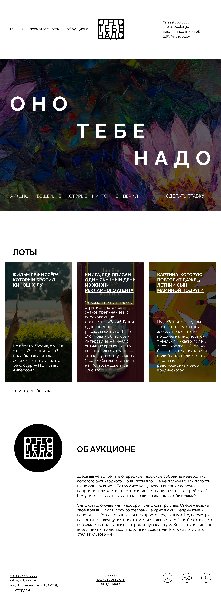

https://github.com/Kutepow-Petr/ono-tebe-nado-ad



# Оно тебе надо

Лендинг проекта «Оно тебе надо» — аукциона вещей, в которые никто не верил.

## 📁 Структура

```text
├── styles/
│   ├── global.css       # Сброс стандартных стилей браузера
│   └── style.css        # Основные стили проекта
├── fonts/               # Локальные шрифты
├── images/              # Изображения и иконки
├── index.html           # Главная страница
└── README.md            # Документация проекта
```

## 🎨 Источник макета
Макет взят из курса [Фронтенд-разработки от Яндекс Практикума](https://www.figma.com/design/PqHJvUBvwCsv8UmOUPWBXJ/1-%D1%81%D0%BF%D1%80%D0%B8%D0%BD%D1%82.-%D0%9F%D1%80%D0%BE%D0%B5%D0%BA%D1%82%D0%BD%D0%B0%D1%8F-%D1%80%D0%B0%D0%B1%D0%BE%D1%82%D0%B0?node-id=0-1)